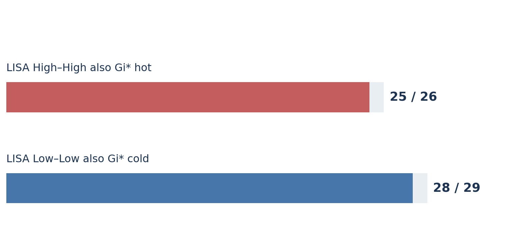
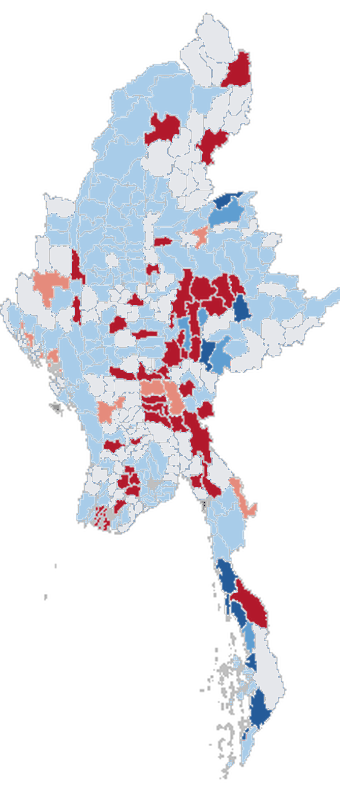
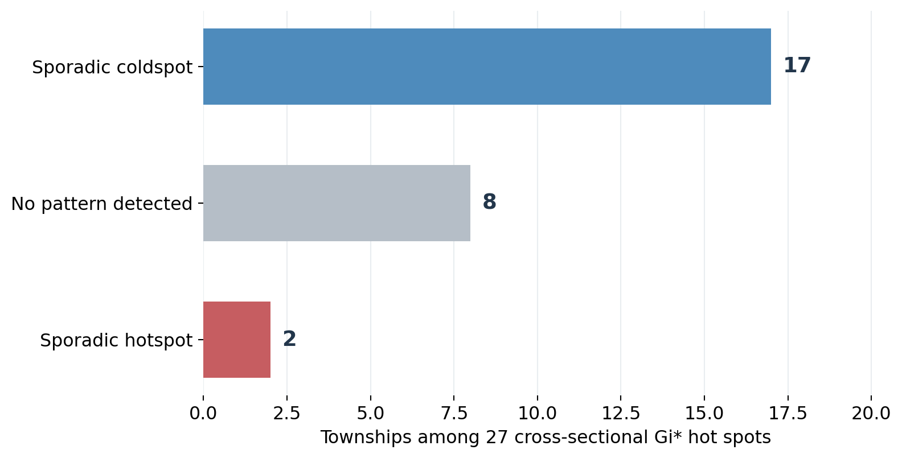
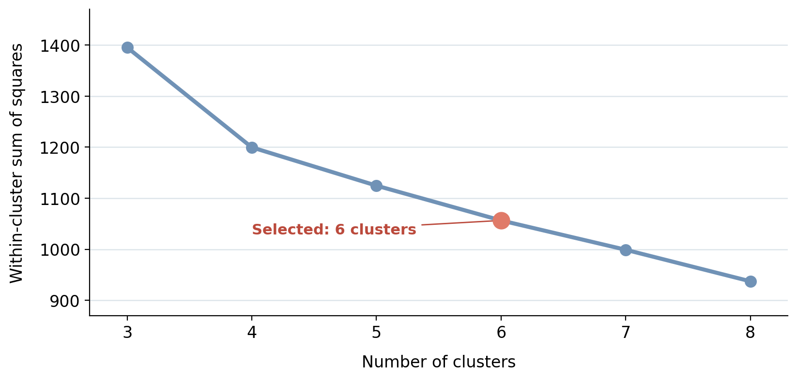
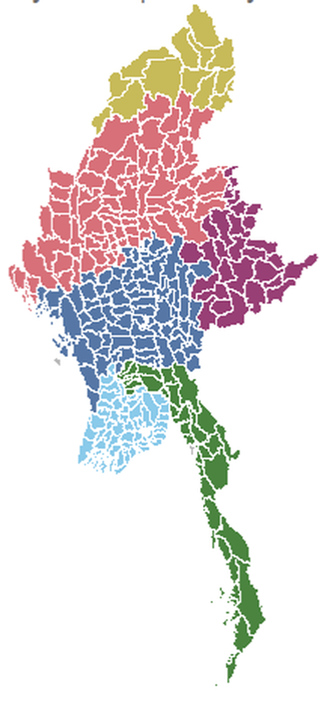
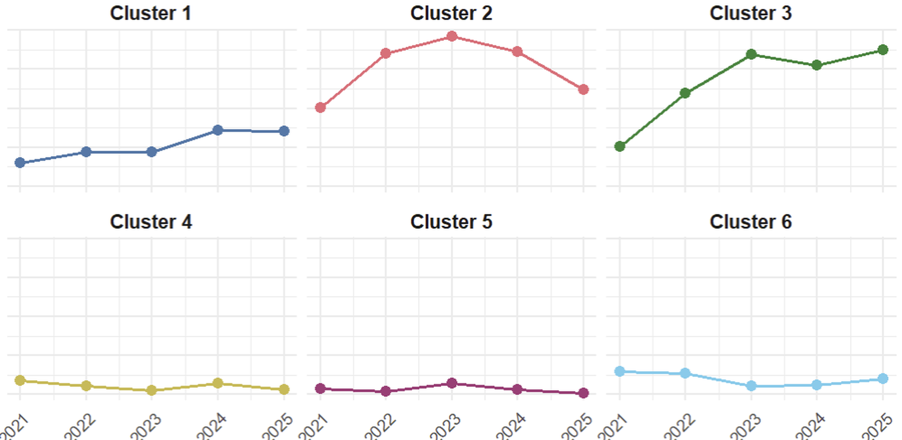

## Contents

1. Study overview
2. Data preparation and quality
3. Analytical framework
4. Cross-sectional clusters: LISA and Gi*
5. EHSA: spatio-temporal patterns
6. Why temporal interpretation matters
7. Selecting the SKATER partition
8. Connected regional groups
9. Cluster temporal profiles
10. Integrated insights and limitations

::: {.callout-note appearance="minimal" icon="false"}
**Note:** This executive summary focuses on the analytical story and visual evidence. Complete code, diagnostics, references and the AI tool declaration are provided in the companion Technical Report.
:::

## 1. Study Overview

:::::::: columns
::::: {.column width="51%"}
::: {.callout-note appearance="simple" icon="false"}
### Central question

**Where are political violence events concentrated across Myanmar townships, how do the patterns change over time, and which geographically connected regions share similar histories?**
:::

::: {.callout-tip appearance="simple" icon="false"}
### Study scope

- **Location:** Myanmar's township (ADM3) boundaries.
- **Time:** January 2021–September 2025.
- **Measure:** recorded political violence **event frequency**, not severity.
:::
:::::

::::: {.column width="45%"}
::: {.callout-note appearance="simple" icon="false"}
### Analytical questions

**Where?** Local Moran's I (LISA).

**How concentrated?** Getis-Ord Gi*.

**How does concentration change?** EHSA.

**Which regions have similar histories?** SKATER.
:::
:::::
::::::::

## 2. Data Preparation and Quality

:::::::: columns
::::: {.column width="48%"}
::: {.callout-note appearance="simple" icon="false"}
### Input and event definition

- **ACLED:** 54,000 eligible records across Battles, Explosions/Remote violence and Violence against civilians; **53,992** spatially matched.
- **MIMU:** complete township boundary dataset.
- **57 monthly periods:** zero-event township-months retained.
:::
:::::

::::: {.column width="48%"}
::: {.callout-tip appearance="simple" icon="false"}
### Key data quality findings

- **330** townships retained after repairing nested GeometryCollections.
- **327** townships included in neighbour-based analysis.
- **3** townships without contiguous neighbours retained on maps separately.
- **18,639** complete township-month observations in EHSA.
:::
:::::
::::::::

::: {.callout-note appearance="minimal" icon="false"}
**Workflow:** ACLED event screening → MIMU boundary repair → spatial assignment → complete monthly panel → spatial and spatio-temporal analysis.
:::

## 3. Analytical Framework

:::::::: columns
::::: {.column width="48%"}
::: {.callout-note appearance="simple" icon="false"}
### LISA — local spatial association

High–High, Low–Low and spatial outliers.
:::

::: {.callout-note appearance="simple" icon="false"}
### Gi* — local concentration

Statistically significant hot and cold spots.
:::
:::::

::::: {.column width="48%"}
::: {.callout-tip appearance="simple" icon="false"}
### EHSA — temporal classification

Sporadic, oscillating and persistent spatial patterns using monthly data.
:::

::: {.callout-tip appearance="simple" icon="false"}
### SKATER — connected regional groups

Contiguous townships with similar yearly violence profiles and event persistence.
:::
:::::
::::::::

::: {.callout-warning appearance="minimal" icon="false"}
**Interpretation boundary:** LISA/Gi* significance, EHSA temporal classification and SKATER cluster membership describe different properties. They are not interchangeable risk scores.
:::

## 4. LISA and Gi* — Strong Spatial Agreement

::::::: columns
::: {.column width="59%"}
{fig-alt="Comparison chart summarising exact LISA and Gi-star classification counts from Technical Report Section 10.4" width="100%"}

*Derived from TR §10.4 comparison table; an agreement chart, not a spatial map.*
:::

::::: {.column width="37%"}
::: {.callout-tip appearance="simple" icon="false"}
### Main findings

- **25 of 26** LISA High–High townships are Gi* hot spots.
- **28 of 29** LISA Low–Low townships are Gi* cold spots.
- Overall Gi*: **27 hot**, **32 cold**.
:::

::: {.callout-note appearance="simple" icon="false"}
### Spatial coverage

Three townships without contiguous neighbours were not tested, but remain on the reference maps.
:::
:::::
:::::::

## 5. EHSA — Monthly Spatial Patterns

:::::::: columns
::: {.column width="39%"}
{fig-alt="EHSA township classifications recoloured using the final Technical Report palette: red hot spots, blue cold spots and grey other statuses" height="620"}
:::

::::: {.column width="57%"}
::: {.callout-tip appearance="simple" icon="false"}
### What the map shows

The **monthly EHSA classifications** distinguish sporadic, oscillating and persistent local spatial patterns. Colours follow TR §11.4 (red = hot; blue = cold; grey = other).
:::

::: {.callout-note appearance="simple" icon="false"}
### Categories present in the results

**Hot spots:** ■ sporadic · ■ oscillating.  
**Cold spots:** ■ sporadic · ■ oscillating · ■ persistent.  
**Other:** ■ no contiguous neighbour · ■ no pattern detected.
:::

::: {.callout-warning appearance="minimal" icon="false"}
**Caution:** A coldspot category describes a relative statistical pattern, not an area that is necessarily safe.
:::
:::::
::::::::

## 6. Why Aggregate and Monthly Patterns Differ

::::::: columns
::: {.column width="60%"}
{fig-alt="Chart derived from Technical Report Section 13.1.1: 17 sporadic coldspots, eight without a pattern and two sporadic hotspots" width="100%"}
:::

::::: {.column width="36%"}
::: {.callout-tip appearance="simple" icon="false"}
### Unexpected result

Among **27** Gi* hot spots:

- **17** sporadic EHSA coldspots
- **8** no pattern detected
- **2** sporadic EHSA hotspots
:::

::: {.callout-warning appearance="simple" icon="false"}
### Interpretation

Gi* uses **full-period aggregated frequency**. EHSA uses **monthly local patterns** and different classification rules; the categories are **not directly equivalent**.
:::
:::::
:::::::

## 7. SKATER — Why Six Clusters?

::::::: columns
::: {.column width="59%"}
{fig-alt="Sensitivity evaluation based on Technical Report Section 12.3.3, comparing within-cluster sum of squares for three to eight SKATER clusters" width="100%"}
:::

::::: {.column width="37%"}
::: {.callout-tip appearance="simple" icon="false"}
### Selected candidate: six clusters

- **5 cuts** to the minimum spanning tree.
- **WSS:** 1,056.38.
- **Smallest cluster:** 13 townships.
- **Largest cluster:** 88 townships, compared with 167 under five clusters.
:::

::: {.callout-note appearance="simple" icon="false"}
### Methodological note

There is no clear WSS elbow. Six groups balance within-cluster similarity, cluster size and geographic interpretability.
:::
:::::
:::::::

## 8. SKATER — Connected Regional Groups

:::::::: columns
::: {.column width="39%"}
{fig-alt="Six SKATER clusters across Myanmar, using the exact cluster colour identities of Technical Report Section 12.4.3" height="620"}
:::

::::: {.column width="57%"}
::: {.callout-tip appearance="simple" icon="false"}
### Cluster sizes

| Cluster | Townships |
|---|---:|
| 1 | 88 |
| 2 | 82 |
| 3 | 36 |
| 4 | 13 |
| 5 | 29 |
| 6 | 79 |
:::

::: {.callout-warning appearance="minimal" icon="false"}
The **327** clustered townships are contiguous within their assigned group. The three isolated townships are shown separately. Cluster labels are **not** severity rankings.
:::
:::::
::::::::

## 9. Temporal Profiles by SKATER Cluster

{fig-alt="Six temporal profile panels reproduced from Technical Report Section 12.5, with common vertical scale and 2025 January–September coverage" width="94%"}

::: {.callout-tip appearance="minimal" icon="false"}
**Distinct trajectories:** Cluster 2 peaks in 2023 then declines; Cluster 3 rises strongly and rebounds in 2025; Clusters 4 and 5 remain comparatively low.
:::

*Annual values are average monthly recorded events per township; 2025 covers January–September only. Descriptive patterns are not trend significance tests.*

## 10. Integrated Insights, Applications and Limits

:::::::: columns
:::: {.column width="32%"}
::: {.callout-tip appearance="simple" icon="false"}
### Where to investigate

**23 of 27** Gi* hot spots are in Cluster 2. Cluster 5 contains **21 of 32** Gi* cold spots (21/29 of its townships).
:::
::::

:::: {.column width="32%"}
::: {.callout-note appearance="simple" icon="false"}
### Why time is essential

**17 of 27** full-period Gi* hot spots are EHSA sporadic coldspots. Overall concentration is not the same as monthly persistence.
:::
::::

:::: {.column width="32%"}
::: {.callout-note appearance="simple" icon="false"}
### How regions differ

SKATER groups neighbouring townships with similar historical frequency patterns, supporting regional monitoring perspectives.
:::
::::
::::::::

::: {.callout-warning appearance="minimal" icon="false"}
**Limits:** historical records are not current safety estimates. Event counts are not severity; reporting and location uncertainty remain; 2025 has only nine months; descriptive patterns are not causal explanations.
:::

**Sources:** ACLED conflict events and codebook; MIMU township boundaries; Su Mon (ACLED, 2024); CFR Global Conflict Tracker; *R for Geospatial Data Science and Analytics*, Chs. 10–12. Complete APA references, code and AI disclosure are included in the Technical Report.

## 11. References

For complete data preparation, methodology, diagnostics, code and interpretation: View the full [Technical Report](https://isss-626-course.vercel.app/take-home_exercise/take-home_ex2_tr.html)