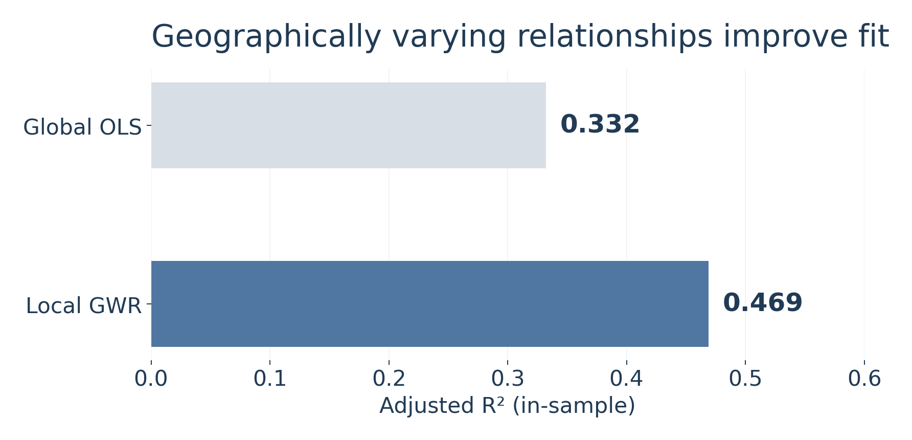
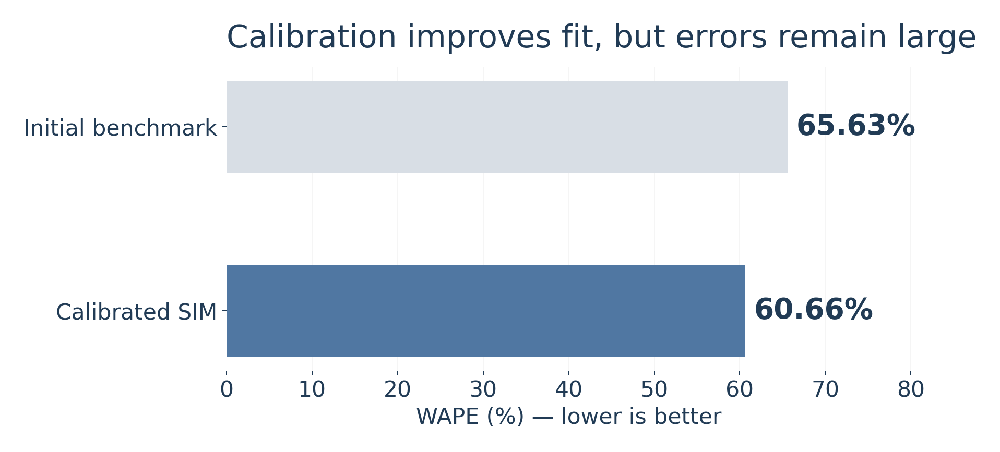
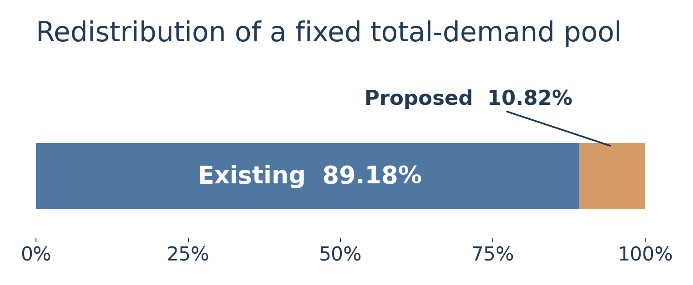
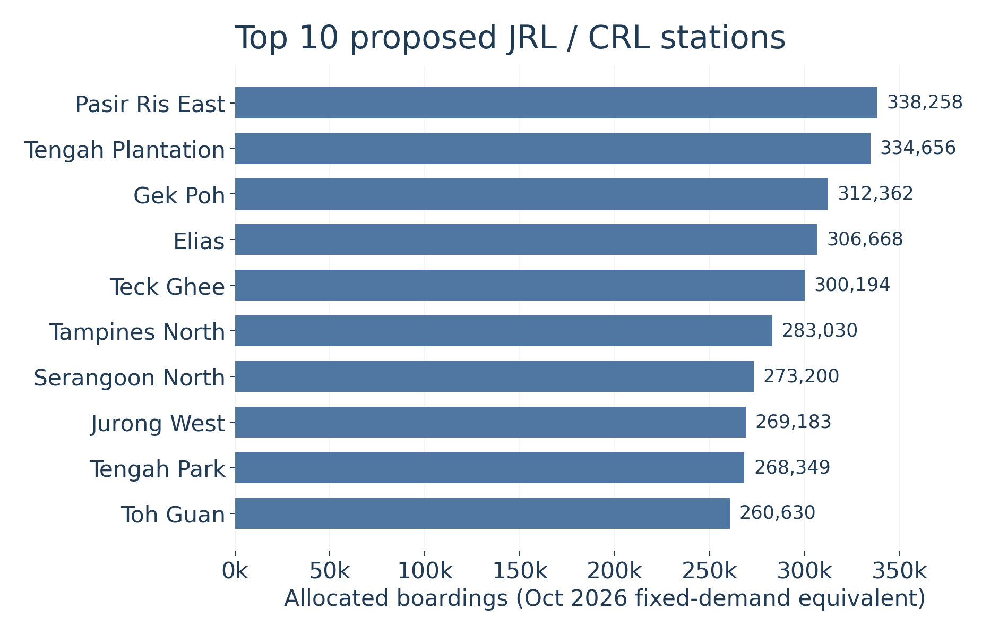
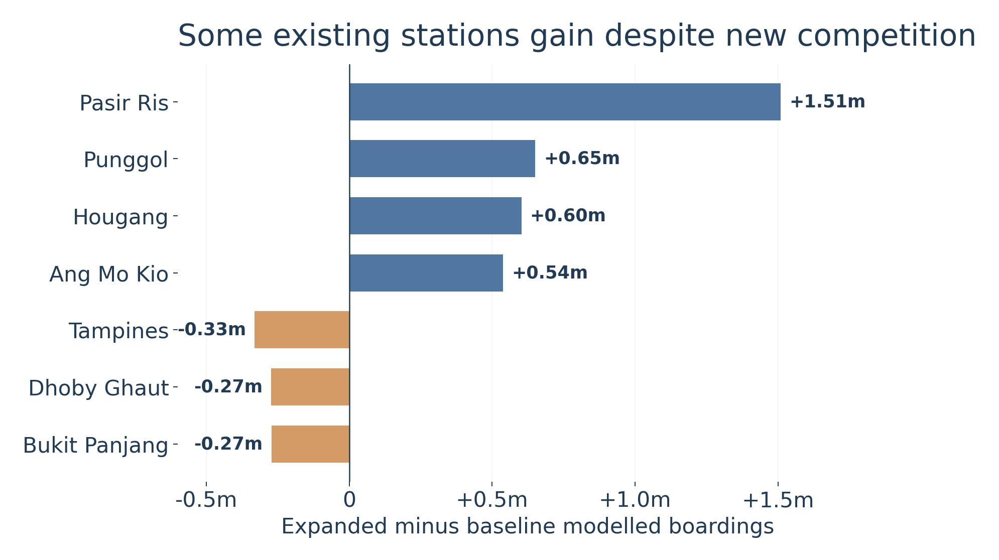
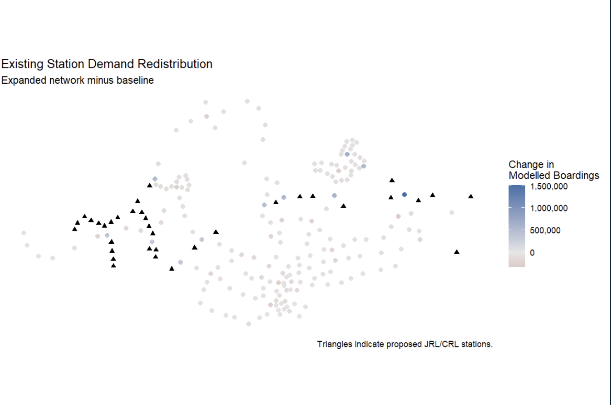
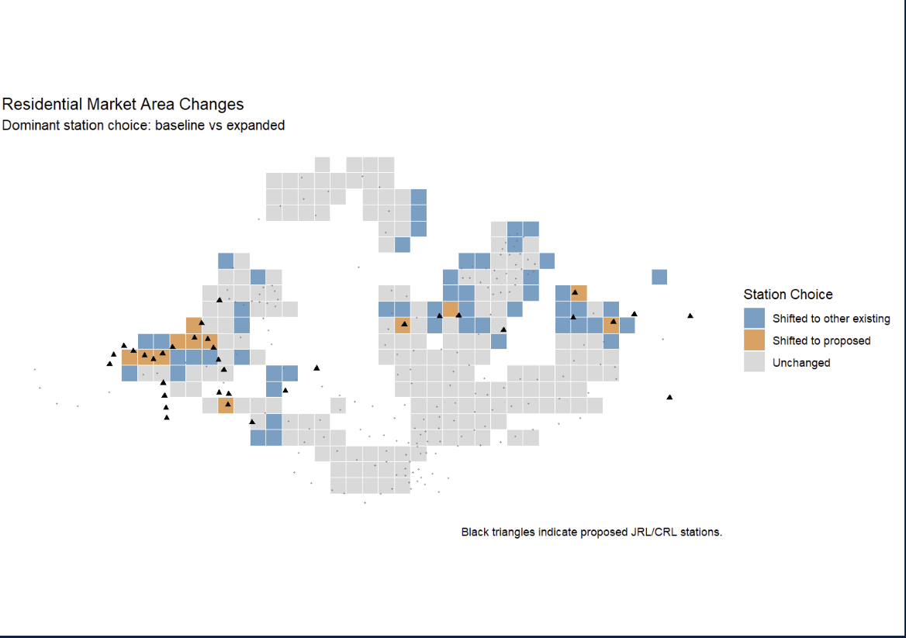
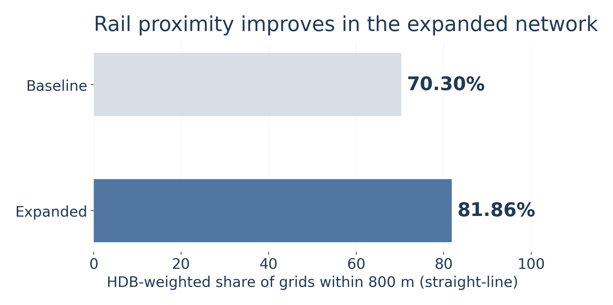

## Contents

1. **Study Overview and Questions**
2. **Data Preparation and Scenario Design**
3. **Analytical Framework**
4. **Existing Ridership: OLS and GWR**
5. **SIM Calibration and Baseline Fit**
6. **Expanded Network Demand Allocation**
7. **Proposed Station Demand**
8. **Existing Station Demand Redistribution**
9. **Spatial Redistribution and Market Areas**
10. **Residential Rail Accessibility**
11. **Parameter Sensitivity and Planning Implications**
12. **References**

::: {.callout-note appearance="minimal" icon="false"}
**Note:** This executive summary highlights the analytical story, key figures and interpretation boundaries. Detailed data processing, code, diagnostics and the AI-tool declaration are provided in the companion Technical Report.
:::

## 1. Study Overview — What Happens When New Stations Compete for Demand?

:::::::: columns
::::: {.column width="51%"}
::: {.callout-note appearance="simple" icon="false"}
### Central question

**How might planned Jurong Region Line (JRL) and Cross Island Line (CRL) stations redistribute residential-origin demand across Singapore's existing MRT/LRT network?**
:::

::: {.callout-tip appearance="simple" icon="false"}
### Study scope

- **Reference:** October 2026 *weekday boardings*, aggregated over the month.
- **Geography:** Singapore MRT/LRT stations and 1 km HDB residential origin grids.
- **Scenario:** existing network compared with a hypothetical expanded JRL/CRL network.
:::
:::::

::::: {.column width="45%"}
::: {.callout-note appearance="simple" icon="false"}
### Four analytical questions

**Q1 — Where and why?**  Are station ridership associations spatially varying?

**Q2 — How well?**  Can a calibrated SIM reproduce station boarding shares?

**Q3 — What changes?**  How is demand distributed across the expanded network?

**Q4 — Where is the impact?**  Which residential market areas and access measures change?
:::
:::::
::::::::

## 2. Data Preparation and Scenario Design

:::::::: columns
::::: {.column width="48%"}
::: {.callout-note appearance="simple" icon="false"}
### Analysis-ready inputs

- **243** residential HDB origin grids (1 km).
- **184** existing MRT/LRT stations in the reference-month network.
- **35** proposed JRL/CRL stations; **219** stations in the expanded scenario.
- **68,808,352** observed October weekday boardings, used to normalise total modelled demand.
:::

::: {.callout-note appearance="simple" icon="false"}
### Data sources

**LTA DataMall:** station boardings  
**HDB / data.gov.sg:** building locations  
**Station reference:** location and station-code mapping  
**URA MP2025:** supplementary planning context
:::
:::::

::::: {.column width="48%"}
::: {.callout-tip appearance="simple" icon="false"}
### Comparable network scenarios

| Scenario | Stations | Interaction pairs |
|---|---:|---:|
| Existing | **184** | **44,712** |
| Expanded | **219** | **53,217** |

Both scenarios use the **same 243 origins** and fixed aggregate demand.
:::

::: {.callout-warning appearance="simple" icon="false"}
### Interpretation boundary

Proposed stations receive **modelled shares of existing demand**. The analysis does **not** forecast induced trips or future network-wide patronage.
:::
:::::
::::::::

## 3. Analytical Framework — From Spatial Relationships to Scenario Allocation

:::::::: columns
::::: {.column width="48%"}
::: {.callout-note appearance="simple" icon="false"}
### A. What explains observed ridership?

**EDA → OLS → Moran's I → GWR**

Estimate associations with residential concentration, station connectivity and spacing; test residual spatial structure and local variation.
:::

::: {.callout-note appearance="simple" icon="false"}
### B. How are station choices modelled?

**Residential origins → Huff probabilities → Station allocation**

$$P_{ij} = \frac{A_j^{\gamma}d_{ij}^{-\beta}}{\sum_k A_k^{\gamma}d_{ik}^{-\beta}}$$

Attractiveness = station-code proxy; distance = Euclidean separation.
:::
:::::

::::: {.column width="48%"}
::: {.callout-tip appearance="simple" icon="false"}
### C. How do new stations affect the network?

**Calibrate on existing stations**  
↓  
**Apply the same parameters to 219 stations**  
↓  
**Compare station allocations and origin choices**  
↓  
**Map market-area and accessibility changes**
:::

::: {.callout-warning appearance="simple" icon="false"}
### Distinct model purposes

GWR describes *associations* in observed station data; the probabilistic SIM allocates *fixed potential demand*. GWR coefficients are **not transferred** into the Huff model.
:::
:::::
::::::::

## 4. Existing Ridership — Why Examine Local Relationships?

::::::: columns
::: {.column width="59%"}
{fig-alt="GWR adjusted R squared 0.469 versus OLS 0.332" width="100%"}

*Same variables and 184 station observations; comparison is in-sample.*
:::

::::: {.column width="37%"}
::: {.callout-tip appearance="simple" icon="false"}
### Model comparison

- **AICc:** 489.21 (OLS) → **456.22** (GWR).
- **Residual Moran's I:** +0.179 (OLS) → **−0.020** (GWR).
- Adaptive GWR bandwidth: **24** nearest neighbours.
:::

::: {.callout-warning appearance="simple" icon="false"}
### Caution

**21 of 184** stations exceed a local condition number of 30. Improved fit does not remove local coefficient instability or establish predictive accuracy.
:::
:::::
:::::::

## 5. Calibrated Spatial Interaction Model — Does It Reproduce Existing Demand?

::::::: columns
::: {.column width="59%"}
{fig-alt="WAPE declines from 65.63 percent benchmark to 60.66 percent calibrated SIM" width="100%"}

*WAPE measures total absolute station-allocation error relative to observed boardings.*
:::

::::: {.column width="37%"}
::: {.callout-note appearance="simple" icon="false"}
### Selected calibration

- Attraction exponent: **γ = 1.7456**.
- Distance decay: **β = 1.1258**.
- Objective: **0.1984 → 0.1508**.
- Station-level **Pearson r = 0.586**.
:::

::: {.callout-warning appearance="simple" icon="false"}
### What the metric does *not* imply

The model conserves **68.81 million** total boardings by construction, but has **60.66% WAPE**. Station-level fit is limited; evaluation uses the same station data as calibration.
:::
:::::
:::::::

## 6. Expanded Network — How Much Demand Goes to Proposed Stations?

:::::::: columns
::::: {.column width="55%"}
{fig-alt="Proposed stations receive 10.82 percent and existing stations 89.18 percent of total modelled boardings" width="100%"}

::: {.callout-note appearance="simple" icon="false"}
### Fixed-demand comparison

All **68.81 million** modelled boardings remain in the network; introducing 35 proposed stations changes **where** demand is allocated, not **how much** total demand exists.
:::
:::::

::::: {.column width="41%"}
::: {.callout-tip appearance="simple" icon="false"}
### Main expanded scenario

**7,442,727** boardings allocated to proposed JRL/CRL stations.

**10.82%** of the existing modelled demand pool.

Remaining **61,365,625** allocated to existing stations.
:::

::: {.callout-warning appearance="simple" icon="false"}
### Scenario assumption

All proposed stations have a connectivity attractiveness value of **1**; affected existing interchanges receive updated connectivity values.
:::
:::::
::::::::

## 7. Proposed Stations — Where Is Modelled Demand Highest?

::::::: columns
::: {.column width="62%"}
{fig-alt="Ten proposed JRL CRL stations ranked by modelled boardings, led by Pasir Ris East and Tengah Plantation" width="100%"}
:::

::::: {.column width="34%"}
::: {.callout-tip appearance="simple" icon="false"}
### Top three proposed stations

1. **Pasir Ris East — 338,258**
2. **Tengah Plantation — 334,656**
3. **Gek Poh — 312,362**
:::

::: {.callout-note appearance="simple" icon="false"}
### Reading the ranking

Relative differences reflect the assumed HDB market potential, straight-line distances and competition among **all 219** stations.
:::

::: {.callout-warning appearance="simple" icon="false"}
**Not a forecast:** Values are conditional allocations on the October 2026 demand baseline, not opening-year station ridership.
:::
:::::
:::::::

## 8. Existing Stations — Competition and Connectivity Work Together

::::::: columns
::: {.column width="62%"}
{fig-alt="Diverging chart of modelled demand changes at selected existing stations, with strong gain at Pasir Ris and losses at Tampines Dhoby Ghaut and Bukit Panjang" width="100%"}
:::

::::: {.column width="34%"}
::: {.callout-tip appearance="simple" icon="false"}
### Largest changes

- **Pasir Ris:** +1.51m (+361.93%).
- **Punggol:** +651k.
- **Hougang:** +602k.
- **Tampines:** −330k.
:::

::: {.callout-warning appearance="simple" icon="false"}
### Why Pasir Ris rises so much

Its assigned connectivity attractiveness changes from **1 → 3**. The Huff exponent amplifies that assumption; it is **not evidence of real-world 362% ridership growth**.
:::
:::::
:::::::

## 9. Where Does Existing Station Demand Change?

::::::: columns
::: {.column width="63%"}
{fig-alt="Station map showing modelled boarding changes for existing MRT stations with proposed lines shown as black triangles" width="100%"}
:::

::::: {.column width="33%"}
::: {.callout-note appearance="simple" icon="false"}
### Spatial interpretation

Changes are **not uniformly negative** near proposed stations. Some existing stations gain allocations because their assumed connectivity also improves.
:::

::: {.callout-tip appearance="simple" icon="false"}
### Comparison rule

Each impact is **expanded estimated boardings − baseline estimated boardings**, under the *same* model parameters.
:::
:::::
:::::::

## 10. Residential Market Areas — Which Origins Change Their Top Choice?

::::::: columns
::: {.column width="63%"}
{fig-alt="HDB grid map with 179 unchanged dominant station choices, 52 shifted to another existing station, and 12 shifted to proposed stations" width="100%"}
:::

::::: {.column width="33%"}
::: {.callout-tip appearance="simple" icon="false"}
### Dominant-choice transitions

- **179 / 243** grids unchanged.
- **52 / 243** shift to another existing station.
- **12 / 243** shift to proposed stations.
- Total changed: **64 / 243** (**26.3%**).
:::

::: {.callout-warning appearance="simple" icon="false"}
### Not hard passenger boundaries

Median highest station-choice probability is only **9.11%**. A dominant station is merely the **largest probability**, not an exclusive catchment.
:::
:::::
:::::::

## 11. Residential Accessibility — Is Rail Proximity Improved?

::::::: columns
::: {.column width="59%"}
{fig-alt="800 metre HDB weighted station proximity coverage rises from 70.30 percent to 81.86 percent" width="100%"}

*Gain: **11.56 percentage points** under the expanded scenario.*
:::

::::: {.column width="37%"}
::: {.callout-tip appearance="simple" icon="false"}
### Mean distance to nearest station

**674.22 m → 546.53 m**

A reduction of **127.69 m**, weighted by HDB buildings across the 1 km origin grids.
:::

::: {.callout-warning appearance="simple" icon="false"}
### Measurement boundary

Coverage uses **grid centroids and Euclidean distance**. It is not equivalent to each HDB building being within an 800 m walking route.
:::
:::::
:::::::

## 12. Parameter Sensitivity — Aggregate Stability Can Hide Local Uncertainty

:::::::: columns
::::: {.column width="48%"}
::: {.callout-tip appearance="simple" icon="false"}
### Proposed-station share

| Parameter set | Proposed share |
|---|---:|
| Preferred interior | **10.82%** |
| Alternative boundary | **11.17%** |

The overall share remains relatively similar across the two calibrated solutions.
:::

::: {.callout-warning appearance="simple" icon="false"}
### Yet dominant market areas differ

- Preferred: **12** origin grids favour a proposed station.
- Alternative: **0** grids favour a proposed station.

The alternative solution uses **β = 0.10**, the lower search bound.
:::
:::::

::::: {.column width="48%"}
::: {.callout-note appearance="simple" icon="false"}
### Why this matters

The model can assign **non-zero probability** to new stations without making any one of them the dominant choice for a residential grid.
:::

::: {.callout-note appearance="simple" icon="false"}
### Implication for decision-making

Use the model for **scenario screening** and sensitivity exploration. Do not present precise grid boundaries or future boardings as validated passenger forecasts.
:::
:::::
::::::::

## 13. Integrated Insights, Planning Uses and Limits

:::::::: columns
::::: {.column width="32%"}
::: {.callout-tip appearance="simple" icon="false"}
### Where access may improve

The expanded network brings more HDB-grid centroids within an **800 m** straight-line radius of a station.
:::
:::::

::::: {.column width="32%"}
::: {.callout-note appearance="simple" icon="false"}
### How competition may change

Proposed stations gain demand, but some existing interchange stations also gain because their **connectivity proxy changes**.
:::
:::::

::::: {.column width="32%"}
::: {.callout-note appearance="simple" icon="false"}
### Where further evidence is needed

Prioritise **population and employment data**, pedestrian paths, feeder services, and observed residential travel choices before forecasting.
:::
:::::
::::::::

::: {.callout-warning appearance="simple" icon="false"}
### Key limitation and final takeaway

**WAPE = 60.66%**, limited attraction measures and uncertain distance decay constrain station-level reliability. The strongest findings are about **potential accessibility improvement and conditional redistribution**, not the precise future ridership of individual stations.
:::

## References

### Data and analytical sources

- **Land Transport Authority (LTA) DataMall** — October 2026 station boardings and network context.
- **Housing & Development Board (HDB), data.gov.sg** — residential building geometries.
- **Urban Redevelopment Authority (URA)** — Master Plan 2025 Rail Station Layer (supplementary context).
- **Station coordinate reference** — Singapore Train Station Coordinates repository.
- **Huff (1964), Gollini et al. (2015), Bivand & Wong (2018)** — analytical foundations; full citations in the Technical Report.

### Full Technical Report

For complete methodology, diagnostics, underlying code, references and AI disclosure: [**View the full Technical Report**](https://isss-626-course.vercel.app/take-home_exercise/take-home_ex3_tr.html)